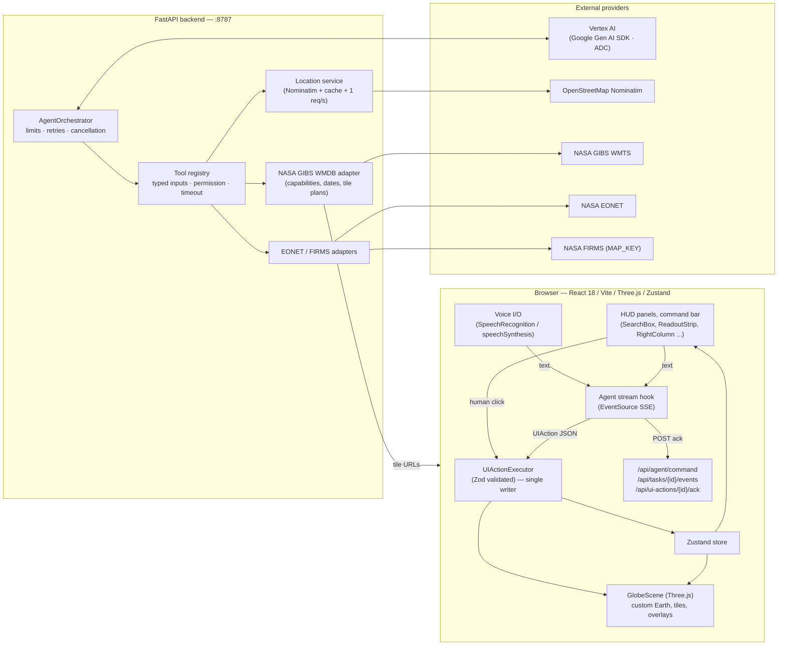
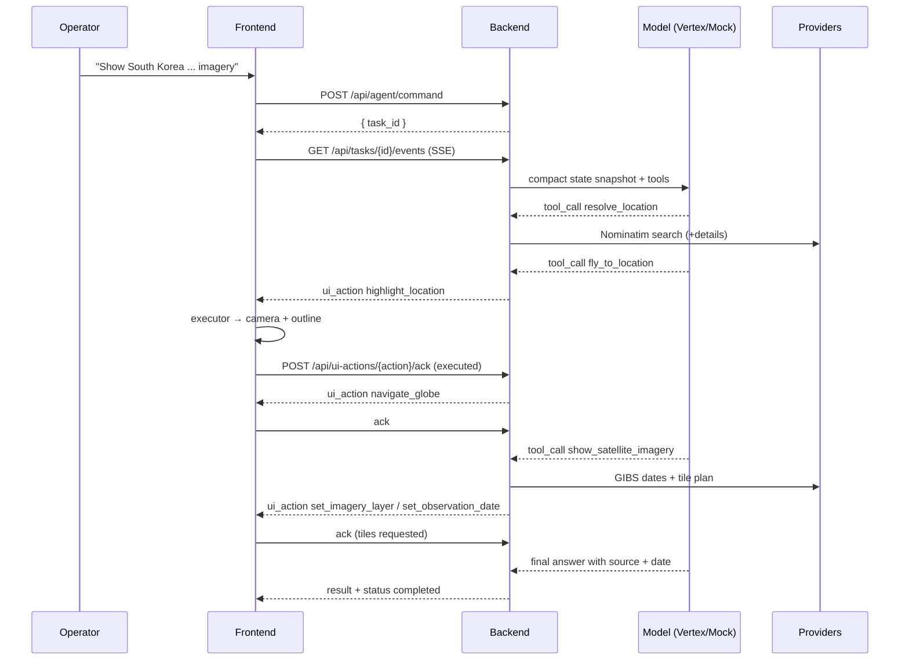

# S.A.T.U.R.N. — Architecture

## 1. System overview



## 2. Command lifecycle (agent-controlled UI)



The model never claims an action happened before the browser ACK arrives. `STOP` cancels the
task, unblocks pending actions and tells the browser to stop executing new ones.

## 3. Frontend structure

| Layer | Files | Responsibility |
|---|---|---|
| Design system | `styles/theme.css`, `styles/console.module.css`, `styles/loader.module.css` | tokens sampled from the reference; 1456×720 design canvas scaled by `--scale` |
| Globe | `globe/GlobeScene.ts`, `globe/GlobeController.ts`, `globe/textures.ts` | custom Three.js Earth, orbit controls, flyTo, tiles, overlays, labels |
| State | `state/useSaturnStore.ts` | camera, layers, overlays, regions, agent, logs, panels |
| Commands | `uiActions/schema.ts`, `uiActions/executor.ts` | Zod contract + the only state writer for both humans and agent |
| Transport | `api/client.ts`, `hooks/useAgentStream.ts` | typed REST + SSE, ACK round-trip |
| Voice | `hooks/useVoice.ts` | push-to-talk, TTS, graceful fallbacks |
| UI | `components/**` | panels, readout strip, command bar, drawers, loader, mobile shell |

Scaling: the three HUD columns and the readout strip are absolutely positioned in the design canvas
(identical proportions to the reference at any resolution); the globe host sits behind the panels.

## 4. Backend structure

| Module | Responsibility |
|---|---|
| `main.py` | routes, CORS, request-id middleware, error mapping |
| `tasks.py` | task bus: event history, SSE fan-out, action ACK futures, cancellation |
| `agent/orchestrator.py` | plan → tools → UI actions → reply, with limits and retries |
| `agent/model_client.py` | `VertexModel` (google-genai, ADC) and deterministic `MockModel` |
| `tools/registry.py` | typed tools with permission level, timeout and honest error format |
| `ui_actions/registry.py` | Pydantic mirror of the Zod schema + argument validation |
| `geo/*` | coordinate maths, Nominatim client (cache + throttle), resolution workflow |
| `imagery/gibs.py` | WMTS capabilities parsing, curated layer set, date validation, tile plans |
| `events/*` | EONET normalisation, FIRMS CSV parsing with explicit "not configured" state |
| `auth.py` | tri-state identity: Firebase ID-token verification, demo, disabled |
| `store.py` | saved regions/views/prefs under `users/{uid}`, Firestore or in-memory |
| `ratelimit.py` | per-user / per-IP token bucket with `Retry-After` |

## 4.1 Authentication and saved data (Phase 8)

```mermaid
flowchart LR
  B[Browser] -->|ID token| API[/api/me/**]
  API --> AUTH{auth_mode}
  AUTH -->|firebase| V[Verify with Firebase Admin SDK]
  AUTH -->|demo| D[Shared demo identity]
  AUTH -->|disabled| X[503]
  V --> UID[uid from token]
  UID --> ST[store: users/uid/...]
  ST -->|project configured| FS[(Firestore)]
  ST -->|no project| MEM[(process memory)]
```

Three rules keep this honest:

1. **The uid comes from the token, never the request body.** There is no code path that can
   address another user's collection, and Firestore rules enforce the same boundary for direct
   client access.
2. **The mode is always published.** `/api/auth/config` reports `mode`, `storage` and
   `persistent`, and the notice text changes to match. If accounts exist but storage is in-memory,
   the notice says the data is lost on restart rather than inviting the user to save.
3. **Verification fails closed.** If the Admin SDK or credentials are unavailable the request is
   rejected with 401; an unverified token is never trusted.

## 5. Data-ownership rules

1. The browser owns *presentation* state; the backend owns *provider* access and the model.
2. No secret is ever sent to the browser.
3. The model receives a compact snapshot (`state_snapshot_text`), never imagery or full history.
4. Every provider result carries `Provenance` (provider, product, observation time, retrieval
   time, freshness, attribution).
